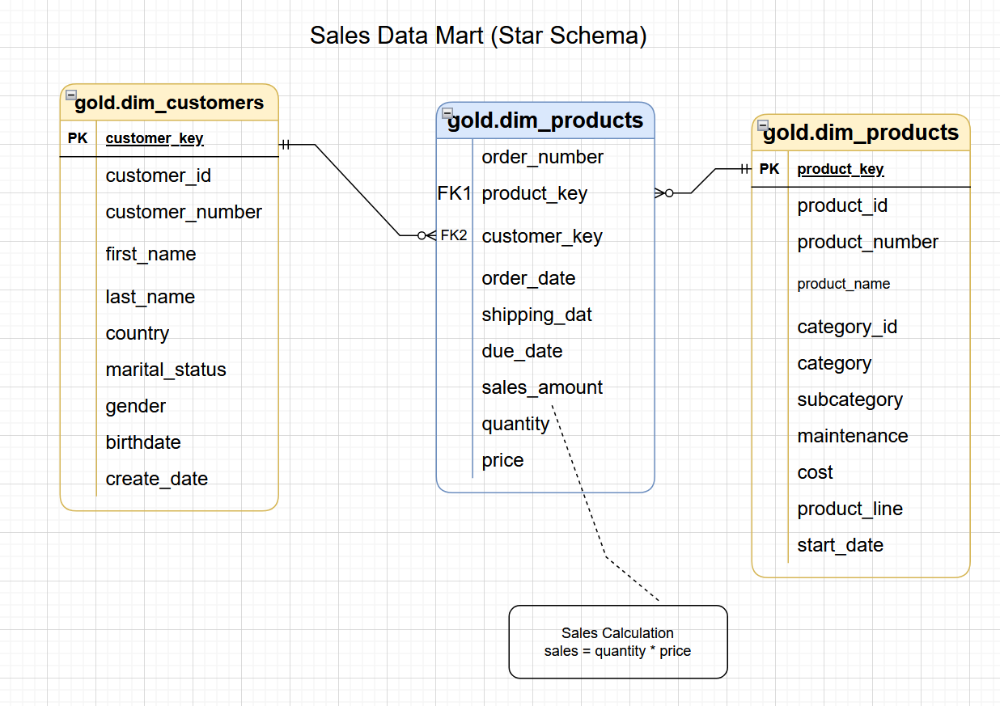

# Sales Data Warehouse and Analytics (SQL Server + Power BI)

An end-to-end sales analytics platform: a SQL Server data warehouse (bronze, silver, gold) loaded nightly from two source systems, a star schema with product history, analytical SQL, and a three-page Power BI dashboard.

**What's in it:**
- **SCD Type 2 product dimension**: sales are matched to the product version (and cost) valid on the order date
- **Transaction-safe loads**: each layer loads in a single transaction with `XACT_ABORT`, so a failed run rolls back to the last good state instead of leaving tables empty or half-loaded
- **Data quality gate**: a table that loads 0 rows (for example, an empty source file) fails the load, so bad input can't wipe good data
- **ETL logging and error handling**: every table load is logged with row counts, duration, and status; failures are logged after the rollback and re-thrown instead of silently swallowed
- **Nightly automation**: a SQL Server Agent job runs bronze, then silver, every night at 2:00 AM and stops if bronze fails
- **Analytical SQL**: seven business analyses using window functions, including RFM customer segmentation and historical margin analysis
- **Power BI dashboard**: three pages (Executive Overview, Customers, Products & Margin) built on the gold layer

## Dashboard


Three pages: Executive Overview, Customers (RFM segments), and Products & Margin (true margin vs current cost). Screenshots of all pages, the data model, and the DAX measures are in [`powerbi/README.md`](powerbi/README.md).

## Key Findings

**Product history changes the margin story**

When I first built the product dimension, I only kept the current version of each product, which meant every past sale was costed at today's price. Once I kept the full history (SCD Type 2), the margins for earlier years looked quite different:

| Year | Margin (cost at time of sale) | Margin (today's cost) | Cost difference |
|------|------|------|------|
| 2011 | 40.2% | 39.9% | $22K |
| 2012 | 42.0% | 35.2% | $396K |
| 2013 | 43.1% | 41.4% | $286K |

2012 is the big one. Using today's costs would have made that year look almost 7 points worse than it really was, and nearly all of that comes from Bikes. It doesn't always go in the same direction, though. Some Accessories got cheaper over time, so for them the current cost actually makes past margins look slightly better. Either way, without history the numbers for past years are just wrong.

**Repeat customers drive most of the revenue**

I used RFM (recency, frequency, monetary) to group customers. My first version scored frequency with NTILE, but 63% of customers only ever placed one order, so NTILE was putting identical customers into different groups at random. I switched frequency to fixed thresholds (1 order, 2 orders, 3 or more), which made the segments much cleaner.

The result: customers who ordered more than once are only 37% of the customer base but bring in 77% of revenue.

The group I'd pay most attention to is At Risk. They're 11% of customers but 27% of revenue, they've ordered twice on average, and they haven't come back in about 9 months. These are proven repeat buyers going quiet, so if this were a real business, that's where I'd focus a retention campaign first.

**The business changed from a bike shop to a broader retailer**

Until 2012 the company only sold bikes. Accessories and Clothing show up for the first time in 2012, with very small numbers, so they must have launched near the end of that year. In 2013 total sales almost tripled, from $5.8M to $16.3M. Bikes still made up about 94% of it, but the new lines were already bringing in around 6%.

Bike sales actually dropped by about 17% in 2012 before the big jump in 2013. The data doesn't say why, but it's the kind of thing I'd want to ask the business about.

*Note: 2010 and 2014 are partial years (the data covers late December 2010 to January 2014), so I don't use them for year-over-year comparisons. Some growth figures in the raw output look huge for that reason, and I don't treat them as real growth.*

--------------------------------------------------------------------------------------------------------------
## High-Level Data Warehouse Architecture (Medallion Architecture)

| Layer    | Description                     | Object Type | Load Strategy                                      | Transformations                                   | Data Model        |
|----------|---------------------------------|-------------|----------------------------------------------------|---------------------------------------------------|-------------------|
| Sources  | ERP & CRM source systems (CSV)  | Files       | File-based ingestion                               | None                                              | Source format     |
| Bronze   | Raw, as-is data                 | Tables      | Full Load, Truncate & Insert (one transaction)     | None                                              | As-Is             |
| Silver   | Cleaned & standardized data     | Tables      | Full Load, Truncate & Insert (one transaction)     | Cleansing, standardization, derived columns       | As-Is             |
| Gold     | Business-ready data             | Views       | No Load                                            | Aggregations, business logic, integrations        | Star Schema       |
| Consume  | Analytics & insights            | BI Tools    | Read-Only                                          | Reporting, ad-hoc analysis, machine learning      | Semantic Layer    |

**Bronze Layer**: Stores raw data exactly as received from the source systems. Data is loaded from CSV files into the SQL Server database without transformations.

**Silver Layer**: Focuses on cleaning and standardizing the data by applying validation, normalization, and consistency rules to make it ready for analysis.

**Gold Layer**: Contains business-ready data modeled using a star schema to support reporting, analytics, and decision-making.

**Orchestration**: A SQL Server Agent job (`DWH - Nightly Load`) runs the bronze load, then the silver load, every night at 2:00 AM. If bronze fails, the job stops, so silver never runs on bad data. Gold needs no step because its views always read the latest silver data.

### Data Flow (Lineage)
.PNG)

### Data Integration


### Data Model (Star Schema)


Full column definitions for the Gold layer are in the [Data Catalog](docs/data_catalog.md).

--------------------------------------------------------------------------------------------------------------
## Tools Used
- **SQL Server (Developer edition)** – database engine
- **SQL Server Agent** – nightly job scheduling
- **SQL Server Management Studio (SSMS)** – running and managing scripts
- **Power BI Desktop** – dashboard and DAX measures
- **Git, GitHub & VS Code** – version control
- **Draw.io** – architecture and data model diagrams

--------------------------------------------------------------------------------------------------------------

## Repository Structure
```
sql-data-warehouse-project1/
├── analytics/               # Business analysis queries (trends, customers, products, RFM, margin)
├── datasets/
│   ├── source_crm/          # cust_info, prd_info, sales_details (CSV)
│   └── source_erp/          # CUST_AZ12, LOC_A101, PX_CAT_G1V2 (CSV)
├── docs/                    # Architecture diagrams, data model, data catalog, dashboard screenshots
├── scripts/
│   ├── init_database.sql    # Creates the DataWarehouse database and schemas
│   ├── etl/                 # ETL load log table and logging procedure
│   ├── bronze/              # Bronze DDL and load procedure (BULK INSERT, transaction-safe)
│   ├── silver/              # Silver DDL and cleansing/transformation procedure (transaction-safe)
│   ├── gold/                # Gold star-schema views (SCD Type 2 product dimension, RFM view)
│   └── automation/          # SQL Server Agent job for the nightly load
├── tests/                   # Data quality checks for Silver and Gold
├── powerbi/                 # Power BI report (.pbix) and documentation: data model, DAX measures, pages
├── LICENSE
└── README.md
```

--------------------------------------------------------------------------------------------------------------

## How to Run
1. Clone this repository.
2. In `scripts/bronze/proc_load_bronze.sql`, update the file paths in each `BULK INSERT` to point to your local `datasets` folder.
3. Run the scripts in SSMS in this order:
   1. `scripts/init_database.sql` (**warning:** drops and recreates the `DataWarehouse` database)
   2. `scripts/etl/ddl_etl.sql`
   3. `scripts/bronze/ddl_bronze.sql`, then `scripts/bronze/proc_load_bronze.sql`, then `EXEC bronze.load_bronze;`
   4. `scripts/silver/ddl_silver.sql`, then `scripts/silver/proc_load_silver.sql`, then `EXEC silver.load_silver;`
   5. `scripts/gold/ddl_gold.sql`
4. Run the scripts in `tests/` to validate the Silver and Gold layers. Each check should return no rows.
5. Check the load history:
   ```sql
   SELECT * FROM etl.load_log ORDER BY log_id DESC;
   ```
6. Run any query in `analytics/`. Each file starts with the business question it answers.
7. *(Optional)* Schedule the nightly load: start SQL Server Agent, then run `scripts/automation/agent_job_nightly_load.sql`. SQL Server Agent is not available in SQL Server Express. Run the job once on demand with:
   ```sql
   EXEC msdb.dbo.sp_start_job @job_name = N'DWH - Nightly Load';
   ```
8. Open `powerbi/Sales_Margin_Insights.pbix` in Power BI Desktop to explore the dashboard. Refreshing it requires the database from step 3. Details are in [`powerbi/README.md`](powerbi/README.md).

--------------------------------------------------------------------------------------------------------------

## Design Decisions
- **SCD Type 2 for products.** The original brief covered only current data, but costing past sales at today's price gave wrong margins (see Key Findings). The source keeps product history (77 products changed cost over time). Instead of keeping only the current version, the product dimension keeps every version with a validity range, and each sale joins to the version valid on its order date. Result: in 2012, the gross margin using historical cost is **42.0%**, versus **35.2%** if every sale were costed at today's price.
- **Open-ended first version.** About 30% of sales are dated before their product's first recorded start date. A strict date-range join would lose those product links, so the first version of each product is treated as valid from 1900-01-01. A quality check confirms every sale matches exactly one product version.
- **One transaction per layer.** Each load procedure wraps all its tables in a single transaction with `SET XACT_ABORT ON`. If any table fails, the whole layer rolls back, so reports never see empty or half-loaded tables, or a mix of old and new data. I tested this by forcing the last silver table to fail: every silver table kept its previous rows, and the log recorded the failure.
- **Fail on empty loads.** An error isn't the only way a load goes wrong: an empty or truncated source file loads 0 rows without any error. Each table load checks its row count and treats 0 rows as a failure, which triggers the rollback.
- **Log to a table, not just PRINT.** `PRINT` output is lost when the session ends. `etl.load_log` keeps a permanent run history (rows, duration, status, error) that can be queried or monitored. The failure row is written after the rollback, so the rollback can't erase it.
- **Re-throw errors.** The load procedures log the failure and then `THROW`, so the SQL Server Agent job sees a failed load as failed and stops before the next step.
- **Gold as views.** Views keep the gold layer always in sync with silver and are simple to maintain at this data size, and Power BI imports the data at refresh, so views add no report latency. At larger volumes, I would materialize the gold layer as tables with stable `IDENTITY` surrogate keys and indexes, loaded at the end of the pipeline, because `ROW_NUMBER()` keys in views are recalculated on every query. Indexed views are not an option here: SQL Server does not allow outer joins or views built on other views in them, and the SCD Type 2 fact join needs both.
- **Flag, don't delete, suspicious data.** Quality checks flag 15 customers born before 1924. They are kept, since they may be valid, and flagged for source-system review instead of being silently removed. Only birthdates in the future are set to NULL, because they are impossible.

--------------------------------------------------------------------------------------------------------------

## Acknowledgment
Based on Data With Baraa's open-source [SQL Data Warehouse project](https://github.com/DataWithBaraa/sql-data-warehouse-project), which provided the source dataset and the initial bronze, silver, and gold structure. I extended it with an SCD Type 2 product dimension, transaction-safe loads with a data quality gate, ETL logging and error handling, a nightly SQL Server Agent job, automated data quality checks, RFM customer segmentation, historical margin analysis, and a Power BI dashboard.


--------------------------------------------------------------------------------------------------------------

## About Me
Hi! I'm GenetM.
I'm a data and analytics professional with experience in SQL, data warehousing, and Power BI. I enjoy building end-to-end data solutions and turning raw data into insights that support better decisions.