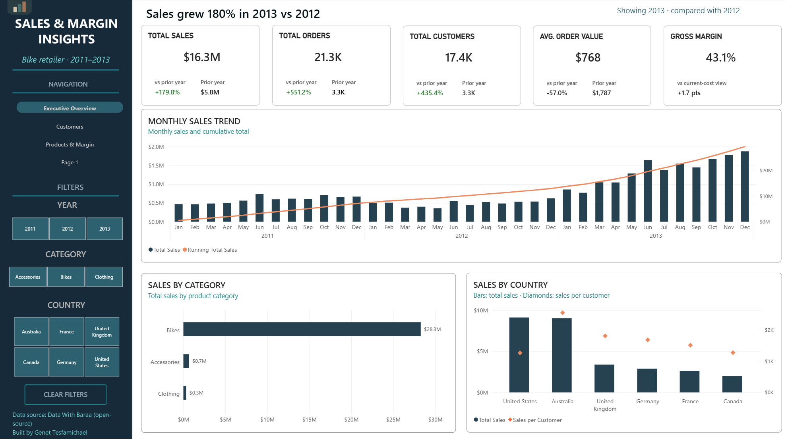
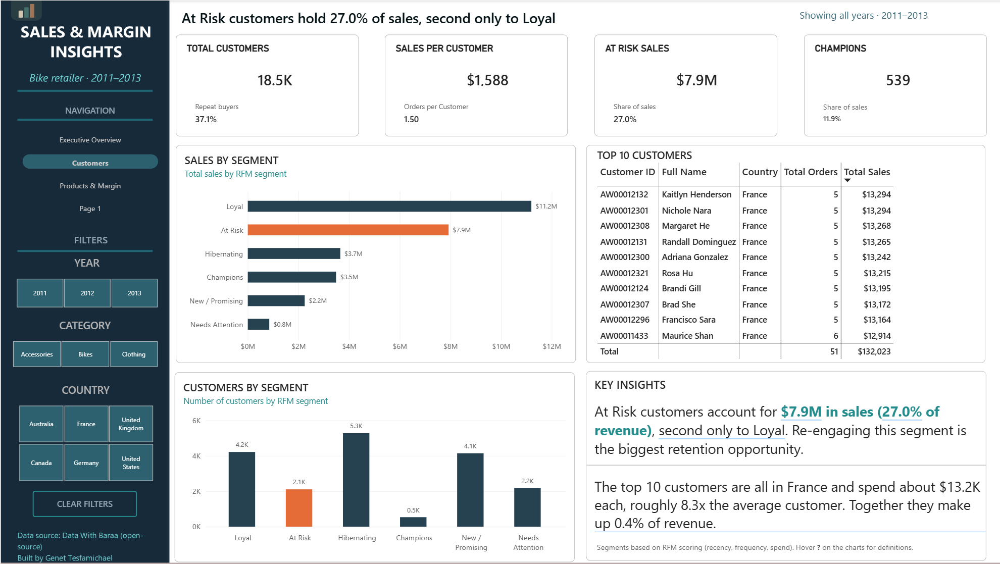
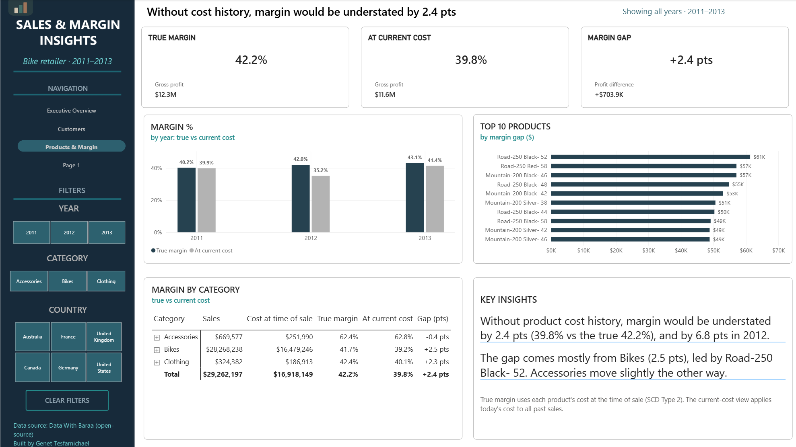

# Power BI Dashboard: Sales & Margin Insights

Three-page sales analytics dashboard built on the Gold layer of the data warehouse (bike retailer, 2011–2013).

> Report file: `Sales_Margin_Insights.pbix` (in this folder). Page screenshots are in `docs/`.

## Screenshots

### Executive Overview


### Customers


### Products & Margin


---

## 1. Data Connection
- **Source:** SQL Server, database `DataWarehouse`
- **Mode:** Import
- **Tables:** `gold.fact_sales`, `gold.dim_customers`, `gold.dim_products`, `gold.customer_rfm`
- Tables were renamed in Power BI without the schema prefix (`fact_sales`, `dim_customers`, `dim_products`, `customer_rfm`).

> **Refresh note:** the `.pbix` stores a copy of the imported data, so anyone can open it and view the report. Refreshing requires the `DataWarehouse` database to be built locally first (see the main README's "How to Run").

## 2. Date Table
Built dynamically from the order dates and rounded to full calendar years, so it extends automatically when new data arrives:
```DAX
DateTable =
ADDCOLUMNS (
    CALENDAR (
        DATE ( YEAR ( MIN ( fact_sales[order_date] ) ), 1, 1 ),
        DATE ( YEAR ( MAX ( fact_sales[order_date] ) ), 12, 31 )
    ),
    "Year", YEAR ( [Date] ),
    "Month Number", MONTH ( [Date] ),
    "Month", FORMAT ( [Date], "MMM" ),
    "Year-Month", FORMAT ( [Date], "YYYY-MM" )
)
```
- Marked as date table.
- `Month` sorted by `Month Number`.
- Auto date/time is turned off, since the model uses this dedicated date table.

## 3. Data Model (Star Schema)
| From (many)                  | To (one)                      | Direction |
|------------------------------|-------------------------------|-----------|
| `fact_sales[product_key]`    | `dim_products[product_key]`   | Single    |
| `fact_sales[customer_key]`   | `dim_customers[customer_key]` | Single    |
| `fact_sales[order_date]`     | `DateTable[Date]`             | Single    |
| `customer_rfm[customer_key]` | `dim_customers[customer_key]` | One-to-one |

Because `dim_products` is SCD Type 2, `fact_sales[product_key]` points to the product **version** valid on the order date.

**Model hygiene**
- Hidden from report view: surrogate keys, `customer_id`, `product_id`, `category_id`, `valid_from`, `valid_to`, `fact_sales[order_date]` (use `DateTable` instead), `DateTable[Month Number]`, and `Current Unit Cost`.
- Summarization set to "Don't summarize" for IDs, RFM scores, `recency_days`, `is_current`, `cost`, and `price`.

## 4. Calculated Column
In `fact_sales`, today's cost of the product sold. It works like a self-join: `RELATED` finds the version sold, and `LOOKUPVALUE` finds the current version of the same product. The gold quality checks guarantee exactly one current version per product.
```DAX
Current Unit Cost =
LOOKUPVALUE (
    dim_products[cost],
    dim_products[product_number], RELATED ( dim_products[product_number] ),
    dim_products[is_current], 1
)
```

## 5. Measures
All measures are stored in the `_Measures` table, organized into display folders. The core measures:

**Sales**
```DAX
Total Sales = SUM ( fact_sales[sales_amount] )
Total Orders = DISTINCTCOUNT ( fact_sales[order_number] )
Total Customers = DISTINCTCOUNT ( fact_sales[customer_key] )
Avg Order Value = DIVIDE ( [Total Sales], [Total Orders] )
```

**Time Intelligence**
```DAX
Sales PY = CALCULATE ( [Total Sales], SAMEPERIODLASTYEAR ( DateTable[Date] ) )
Sales YoY % = DIVIDE ( [Total Sales] - [Sales PY], [Sales PY] )
Running Total Sales =
    CALCULATE (
        [Total Sales],
        FILTER ( ALL ( DateTable[Date] ), DateTable[Date] <= MAX ( DateTable[Date] ) )
    )
```

**Margin**
```DAX
-- RELATED() follows the SCD2 link, so each sale uses the cost valid on its order date
Historical Cost = SUMX ( fact_sales, fact_sales[quantity] * RELATED ( dim_products[cost] ) )
Gross Margin % = DIVIDE ( [Total Sales] - [Historical Cost], [Total Sales] )
```

**Margin\SCD2 Comparison**
```DAX
-- What margin would look like if every sale used today's cost
Current Cost = SUMX ( fact_sales, fact_sales[quantity] * fact_sales[Current Unit Cost] )
Margin % at Current Cost = DIVIDE ( [Total Sales] - [Current Cost], [Total Sales] )
Margin Misstatement (pts) = ( [Gross Margin %] - [Margin % at Current Cost] ) * 100
```

Supporting measures (built on the core measures above) drive the KPI card subtitles and page titles: prior-year values and changes for each KPI, repeat-buyer share, orders and sales per customer, RFM segment sales and share of sales, gross profit at historical and current cost, and the dynamic page titles.

**Validation:** the 2012 results match the SQL analysis (`analytics/07_historical_margin_scd2.sql`): 42.0% margin at historical cost vs 35.2% at current cost.

## 6. Report Pages
Every page has a dynamic headline that states the main finding for the current filter selection, KPI cards with context underneath, and a shared side panel with page navigation, Year / Category / Country slicers, and a Clear Filters button.

### Executive Overview
*How is the business performing?*
- KPI cards: Total Sales, Total Orders, Total Customers, Avg Order Value (each vs prior year), and Gross Margin (vs the current-cost view)
- Combo chart: monthly Total Sales (columns) with Running Total Sales (line)
- Bar chart: Total Sales by category
- Combo chart: Total Sales by country (columns) with Sales per Customer (markers)

### Customers
*Who are our most valuable customers, and who is at risk?*
- KPI cards: Total Customers (with repeat-buyer share), Sales per Customer (with orders per customer), At Risk Sales (with share of sales), Champions (with share of sales)
- Bar chart: Total Sales by RFM segment, with the At Risk segment highlighted
- Column chart: number of customers by RFM segment
- Table: top 10 customers by sales (ID, name, country, orders, sales)
- Key insights panel

### Products & Margin
*What is our true margin, and how wrong would it be without product history?*
- KPI cards: True Margin (historical cost), Margin at Current Cost, and Margin Gap (pts and profit difference)
- Clustered column chart: true margin vs margin at current cost, by year (2011–2013, full years only)
- Bar chart: top 10 products by margin gap ($)
- Matrix: category > subcategory with Sales, Cost at time of sale, True margin, Margin at current cost, and Gap (pts)
- Key insights panel

**Key result:** without product cost history, margin would be understated by 2.4 pts overall (39.8% vs the true 42.2%) and by 6.8 pts in 2012. The gap comes mostly from Bikes.

**Note:** 19 sales have no valid order date and appear under a blank Year. They are excluded from time-based visuals but included in overall totals.